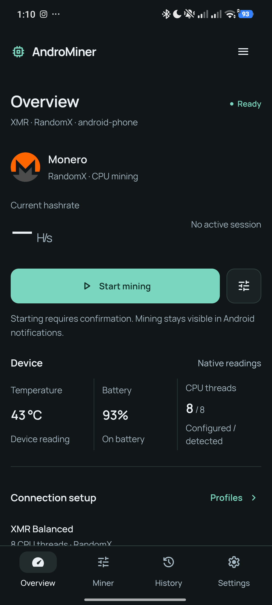
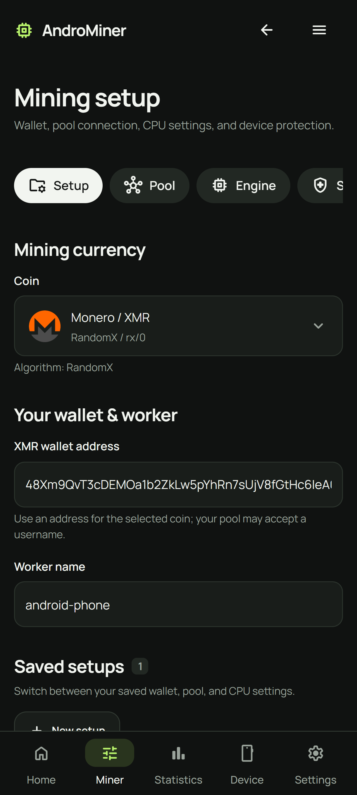
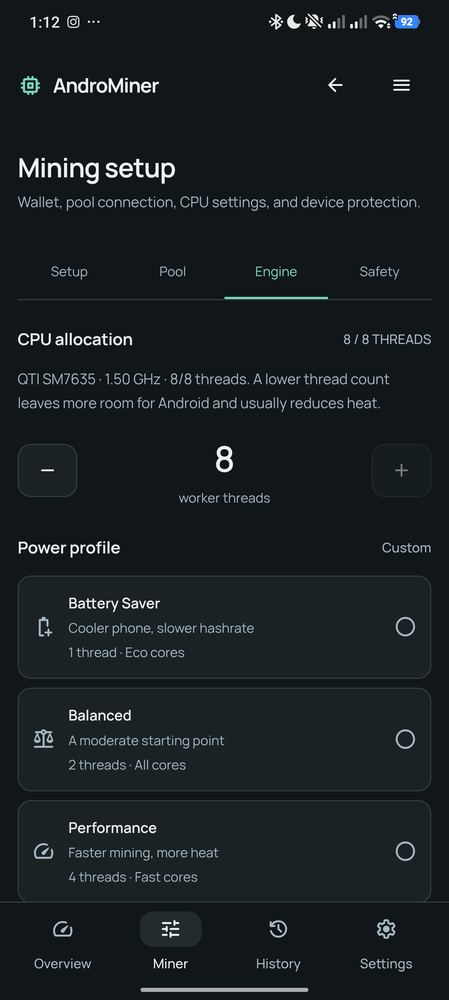
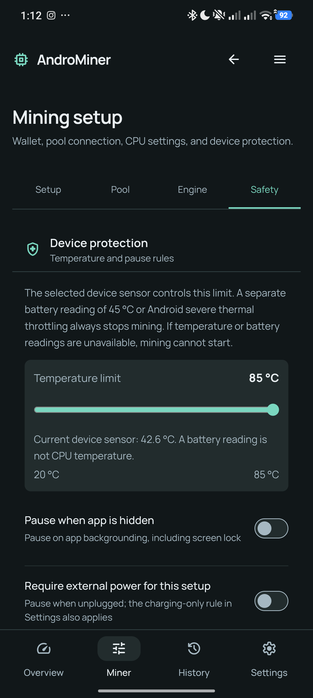
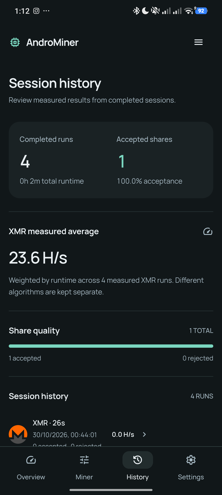
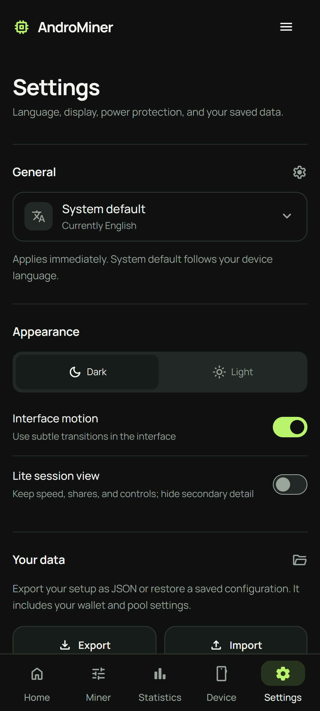

<p align="center">
  
</p>

<h1 align="center">AndroMiner</h1>

<p align="center">
  An open-source Android CPU miner powered by XMRig, with experimental XMRigCC and XLArig engines.<br />
  Configure pools, monitor device readings, and manage mining sessions on your phone.
</p>

<p align="center">
  <a href="#device-compatibility"></a>
  <a href="#development"></a>
  <a href="#development"></a>
  <a href="LICENSE"></a>
</p>

<p align="center">
  <a href="https://github.com/Stawa/AndroMiner/releases"><strong>Download an APK</strong></a>
  &nbsp; · &nbsp;
  <a href="#getting-started">Getting started</a>
  &nbsp; · &nbsp;
  <a href="#building-android-apks">Build from source</a>
</p>

## Screenshots

Real Android 16 device screenshots. Mining remained stopped; History contains
existing runs. The wallet is a placeholder. Tap any image for full size.

<table>
  <tr>
    <td align="center" width="33%">
      <a href="overview/overview.png"></a><br />
      <sub>Overview</sub>
    </td>
    <td align="center" width="33%">
      <a href="overview/miner-setup.png"></a><br />
      <sub>Miner setup</sub>
    </td>
    <td align="center" width="33%">
      <a href="overview/engine.png"></a><br />
      <sub>Engine</sub>
    </td>
  </tr>
  <tr>
    <td align="center" width="33%">
      <a href="overview/safety.png"></a><br />
      <sub>Safety</sub>
    </td>
    <td align="center" width="33%">
      <a href="overview/history.png"></a><br />
      <sub>History</sub>
    </td>
    <td align="center" width="33%">
      <a href="overview/settings.png"></a><br />
      <sub>Settings</sub>
    </td>
  </tr>
</table>

## Features

- Configure supported coins, wallets, workers, and pool connections.
- Choose a CPU profile or adjust threads, priority, and core affinity.
- Follow measured hashrate, accepted and rejected shares, and miner output.
- Monitor available temperature and battery readings, with native protection rules.
- Device protection steps through Normal, Caution, Throttled and Stop, explains each change and keeps the events with the run ([details](docs/device-protection.md)).
- Choose a mining engine: XMRig (supported), or experimental XMRigCC and XLArig (Scala/Panthera). Bundled APKs include all three; the download APK can fetch them once their hashes are pinned. See [mining engines](docs/engines.md) for status, ABIs and what is not verified.
- Ask to restart a crashed miner, and restart it automatically after 30 seconds if there is no answer (Settings → Reliability).
- Save mining setups and session history locally; import or export configuration.
- Set a native session deadline, recover interrupted runs, and retain protection stop reasons.
- Test pool DNS/TCP/TLS reachability without sending a wallet or password.
- Measure the phone's RandomX speed with an offline benchmark (Device tab) and optionally share it anonymously after a warning. Results appear on [andro-miner.vercel.app](https://andro-miner.vercel.app).
- Filter session history and preview a JSON results export with pool identifiers excluded by default.
- Use the app in one of ten languages (Settings → General → Language), or follow the device language.
- Use light or dark mode and swipe between the main pages.
- Install a bundled TLS or no-TLS miner, or download one after confirmation.

## Download & installation

Get an APK from [GitHub Releases](https://github.com/Stawa/AndroMiner/releases),
open it on your phone, and allow installation from that source if Android asks.
For encrypted pool connections without a separate miner download, choose the TLS APK.

| APK                             | Mining engine                 | Pool connections                    |
| ------------------------------- | ----------------------------- | ----------------------------------- |
| `androminer-tls-<tag>.apk`      | Bundled with TLS              | Encrypted or plain TCP              |
| `androminer-notls-<tag>.apk`    | Bundled without TLS           | Plain TCP only                      |
| `androminer-download-<tag>.apk` | Downloaded after confirmation | Choose TLS or no TLS on first start |

### Device compatibility

- The app declares Android 7 / API 24 as its minimum. This does not guarantee
  that the mining engine runs on every device at that API level.
- Mining requires ARM64 (`arm64-v8a`). The native builder targets API 29 by
  default; binary compatibility and available sensors determine whether a device can mine.
- Bundled APKs target SDK 35. The downloader targets SDK 28 so Android permits
  executing the downloaded miner from app storage. Both compile against SDK 36.
- Check **About → Installed mining engine** for the installed binary's details.

## Getting started

1. Read the workload warning and complete the device check.
2. Open **Miner → Setup**, choose a supported coin, and enter your wallet address
   or pool username in place of the placeholder.
3. In **Pool**, enter the host, port, and protocol. Encrypted pools require the TLS miner.
4. Choose a CPU profile in **Engine**. Review **Safety** and
   **Settings → Power & protection** before starting.
5. Enable Android notifications for AndroMiner. Every run requires an ongoing
   notification with a Stop control.
6. Start from **Overview** and confirm the workload. Watch temperature alongside
   hashrate and shares; stop the run to save its results in **History**.

Pausing ends and saves the current run. Resuming starts a new run after confirmation.

## Development

The frontend uses Vue 3, TypeScript, and Vite; Capacitor 8 connects it to the
Android mining and device APIs. Use Node.js 24 and Bun, matching CI.

Run from the repository root:

```sh
bun install --frozen-lockfile
npm run dev
```

The browser preview cannot mine. To typecheck and build the frontend into `dist/`:

```sh
npm run build
```

Validation commands: `npm run lint`, `npm test`, `npm run i18n:check`, `npm run format:check`, and
`npm run test:ui` (requires a running preview and installed Chromium/Edge).
Android checks: `android/gradlew -p android :app:testDebugUnitTest :app:lintDebug spotlessCheck`.
See [validating on a device](docs/engines.md#validating-on-a-device) for device test setup.

## Building Android APKs

Install Android Studio, Android SDK platform 36, and JDK 21. Set `JAVA_HOME` to
the JDK and `ANDROID_HOME` to the SDK, or configure the SDK in `android/local.properties`.

Build the TLS miner first using the [miner builder guide](miner-builder/README.md).
It requires the Android NDK, Git, CMake, and Ninja; TLS builds also need `make`
and a supported Perl installation. The frontend build does not compile XMRig.

The builder installs the executable at
`android/app/src/main/jniLibs/arm64-v8a/libxmrig.so`. TLS and no-TLS builds use
the same destination, so the last miner copied there is the one the APK bundles.
The `minerVariant` property labels the APK; it does not change the binary's TLS support.

### Bundled debug APK

From the repository root in PowerShell:

```powershell
npm run android:sync
.\android\gradlew.bat -p android assembleDebug -PbundleMiner=true -PminerVariant=tls
```

Output: `android/app/build/outputs/apk/debug/app-debug.apk`.
For a no-TLS binary, use `-PminerVariant=notls` instead.
On Linux/macOS, replace `.\android\gradlew.bat` with `./android/gradlew`.

### Signed release APK

Use an existing release keystore or create one with Android Studio. Set all four
signing variables in PowerShell, using that keystore's alias and passwords:

```powershell
$env:ANDROID_KEYSTORE_FILE = "C:/path/to/your-release.jks"
$env:ANDROID_KEYSTORE_PASSWORD = "<keystore-password>"
$env:ANDROID_KEY_ALIAS = "<key-alias>"
$env:ANDROID_KEY_PASSWORD = "<key-password>"

npm run android:sync
.\android\gradlew.bat -p android clean assembleRelease -PbundleMiner=true -PminerVariant=tls
```

Output: `android/app/build/outputs/apk/release/app-release.apk`.
Keep the keystore and credentials private, and retain the signing key for future updates.

<details>
<summary>Local PowerShell release helper</summary>

If you have `scripts/build-release-apk.ps1` locally (the `scripts/` directory is
currently gitignored), it can load the same four signing settings from
`.env.release.local` as `KEY=value` lines:

```dotenv
ANDROID_KEYSTORE_FILE=C:/path/to/your-release.jks
ANDROID_KEYSTORE_PASSWORD=<keystore-password>
ANDROID_KEY_ALIAS=<key-alias>
ANDROID_KEY_PASSWORD=<key-password>
```

```powershell
.\scripts\build-release-apk.ps1 -PbundleMiner=true
```

The helper builds the frontend, syncs Capacitor, and runs the signed release build.
Existing environment variables take precedence over values in the file.

</details>

## Known limitations

- Sensor support varies by phone. Missing required temperature or battery readings
  block mining or stop an active run. A battery sensor is not a CPU temperature sensor.
- **Waiting**, **Stale**, and unavailable readings are not measured zero. The app
  does not calculate earnings or pool payouts.
- The coin list only includes coins that still show signs of life (a maintained project or a live market). Others, such as DERO, ArQmA and Talleo, were removed; see [mining engines](docs/engines.md).
- XMRigCC and XLArig are Experimental: built and checked as binaries for arm64 and ARMv7, not yet run on a device.
  Their downloads in the download APK stay off until reviewed hashes are pinned. See [mining engines](docs/engines.md).
- Starting automatically, background throttling, automatic efficiency-core preference and
  individual event notifications are not implemented. These preferences are disabled in
  Settings; the ongoing mining notification, crash restart and device protection are implemented.
  Intensity reduction pauses the miner in short cycles and has not been verified on every device.
- Clearing app data removes saved setups and history. Configuration exports
  include wallet and pool settings, so review them before sharing.
- Native history retains up to 100 runs and 50 state events per run. After an
  interruption, the end time is the last saved observation, not an exact crash time.
  Automatic Android app backup is disabled; export configurations you want to keep.
- Pool testing checks reachability and TLS certificates, not wallet authentication.
  The connection report excludes identifiers and raw logs. History results exports
  are separate from configuration exports and omit pool identifiers unless selected.

### Session limits and background operation

In **Miner → Safety**, set a maximum duration from 1 to 1440 minutes; 0 means no
deadline. Android enforces the countdown even while the interface is hidden.
Protection and charging-only rules take precedence. Timer, manual, and protection
stops never resume automatically. Reopening the interface reconnects to the native
run; removing the app from recents ends it. See **Help → Background operation** for
Doze, battery saver, and manufacturer restrictions.

### Verify downloads

Release assets include `SHA256SUMS`. After downloading the listed artifacts, use
`sha256sum -c SHA256SUMS` on Linux, or compare `Get-FileHash <apk> -Algorithm SHA256`
with the published value in PowerShell. Checksums detect changed files; APK signing
key continuity is also needed to authenticate updates.

Downloader APKs accept only the miner revision and SHA-256 hashes embedded in that
APK. Downloads are checked before execution and atomically installed; failed checks
keep the previous file. Legacy unverified files require downloading the approved
version again. This makes engine updates depend on reviewed app updates. Details,
network disclosures, and known validation limits are in
[release and downloads](docs/engines.md#release-and-downloads).

## Safety

Mining keeps the CPU under sustained load. It can overheat a phone, degrade the
battery, and reduce responsiveness. Prefer a spare device and supervise every run.

AndroMiner checks temperature, battery level, charging rules, and Android thermal
status. A battery temperature at or above your temperature limit, or severe thermal throttling, stops mining.
Configured limits and protection checks reduce risk; they are not guarantees.

## Contributing & issues

Translations are welcome; see [localization](docs/localization.md) for how to add a language.

[Report a problem](https://github.com/Stawa/AndroMiner/issues) with your device
model, Android version, APK variant, steps to reproduce, and relevant diagnostic
or miner output. Remove wallet addresses, pool credentials, and other private
details before posting. For code changes, describe the behavior changed and how
you checked it on Android.

## License

AndroMiner application code is licensed under [MIT](LICENSE).
The bundled mining engines are licensed separately under GPLv3: [XMRig](https://github.com/xmrig/xmrig/blob/master/LICENSE),
[XMRigCC](https://github.com/Bendr0id/xmrigCC/blob/master/LICENSE) and
[XLArig](https://github.com/scala-network/XLArig/blob/master/LICENSE). See
[THIRD_PARTY_NOTICES.md](THIRD_PARTY_NOTICES.md) for versions, sources and attribution.
